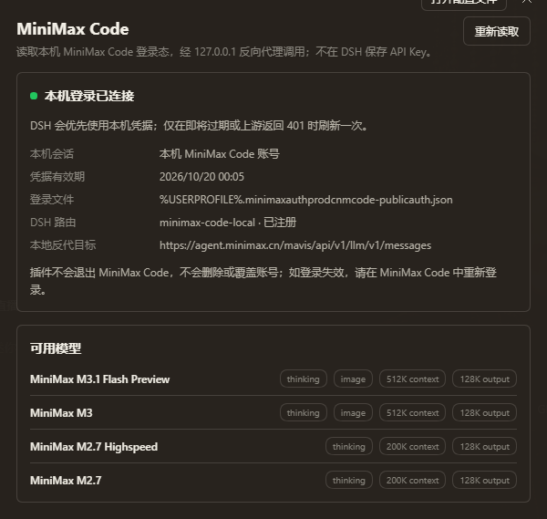
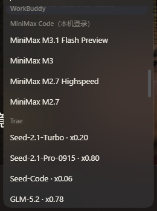

# dsh-connect-minimax

把本机已登录的 MiniMax Code 模型接入 DeepSeek Harness（DSH）。插件不要求另外填写 MiniMax 云 API Key，也不会退出 MiniMax Code 登录。





## 安装

```powershell
dsh plugin --profile desktop add "https://github.com/Yuedalao/dsh-connect-minimax/releases/download/v0.3.1/dsh-connect-minimax.tgz"
```

也可以把下面的地址添加到 DSH 的 **发现 → 索引源**：

```text
https://raw.githubusercontent.com/Yuedalao/dsh-connect-minimax/main/index.json
```

## 工作方式

1. 只读发现 `%USERPROFILE%\.minimax\auth\prod\cn\mcode-public\auth.json` 中的本机 MiniMax Code 凭据。
2. 在 `127.0.0.1` 随机端口启动本地 loopback shim。
3. DSH 的 `pi-ai` provider 通过 Anthropic Messages 协议访问 shim。
4. shim 动态附加本机 `Authorization: Bearer ...`，转发到：
   `https://agent.minimax.cn/mavis/api/v1/llm/v1/messages`
5. access token 即将过期或上游返回 401 时，才使用 refresh token 刷新一次。刷新沿用 MiniMax 自己的 `auth.lock` 协议，原子写回并保留 `loginEpoch`、refresh token 和未知字段。

插件不会删除 `auth.json`、不会执行 OAuth revoke、不会退出 MiniMax Code，也不会把 access token / refresh token 暴露给设置页。

## 模型

- `MiniMax-M3.1-Flash-Preview`
- `MiniMax-M3`
- `MiniMax-M2.7-highspeed`
- `MiniMax-M2.7`

模型 ID、上下文窗口和思考能力来自本机 MiniMax Code `config.yaml` 的实际配置。

- `MiniMax-M3.1-Flash-Preview`、`MiniMax-M3` 支持在插件设置页选择 `512K` / `1M` 上下文，以及 `default` / `low` / `medium` / `high` / `xhigh` / `max` 原生推理等级。
- `1M` 会带来更高用量；插件只修改 DSH 的上下文预算，不会改写或覆盖 MiniMax 登录。
- `MiniMax-M2.7-highspeed`、`MiniMax-M2.7` 保持 `200K`。
- 推理等级未固定时显示“跟随 DSH”，由 DSH 会话里的模型档位控制。
- DSH 模型选择器的 `MiniMax Code（本机登录）` 分组标题会追加真实积分余量（如 `MiniMax Code（本机登录） · 420`）。余额来自 MiniMax Code 桌面端同一只读接口，启动时读取一次并每 5 分钟刷新；读取失败时保留基础名称。
- 余额查询不会保存或展示接口响应中的 API Key，只保留剩余积分、总量、已用量和积分回退开关。

## DSH provider

- Provider：`minimax-code-local`
- Display name：`MiniMax Code（本机登录）`
- 协议：Anthropic Messages

## 配置

默认配置：

```yaml
- id: dsh-connect-minimax
  name: dsh-connect-minimax
  config:
    enabled: true
    dataDir: C:\Users\<user>\.minimax
    region: cn
    maxOutputTokens: 128000
    contextBudgets:
      MiniMax-M3.1-Flash-Preview: 512000
      MiniMax-M3: 512000
    reasoningEfforts: {}
```

设置页可以选择每个模型的 DSH 上下文窗口和 MiniMax 原生推理等级。配置写入后立即刷新模型注册，不需要重启 DSH。页面不提供 API Key 输入框、退出登录或删除凭据按钮。

## 本地开发验证

```powershell
node --check lib/core.js
node --check lib/auth.js
node --check lib/proxy.js
node --check lib/index.js
node --check lib/client.js
node --test
```
